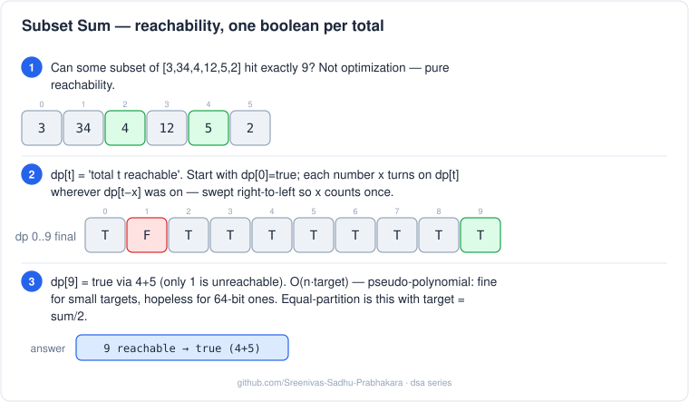

# Subset Sum (DP)

> Striver SDE Sheet 179 · Day 26 DP II — a boolean row of achievable sums; each element shifts the achievable set, swept backwards for single use. Go, stdlib only, tested.

## Problem

Can some subset of the array sum to exactly the target? The decision version of 0/1 knapsack — and the primitive underneath partition-equal-subset, minimal-difference partitioning and count-of-subsets.

## Approach

`dp[s]` says "sum s is achievable with the elements seen so far", seeded by the empty subset (`dp[0] = true`). Each element v upgrades the set: any achievable s−v makes s achievable. The backward sweep over s is the 0/1 discipline again (compare #173) — forward would let v stack on itself. Booleans instead of values make this the cheapest member of the knapsack family: one bit of state per sum. (The recursion take on all subset problems lives back at #049; this is what it looks like once memoized and flattened.)

**Complexity:** O(n · target) time, O(target) space — pseudo-polynomial, which is why the general problem is still NP-complete.

## Visual walkthrough

Read the picture top to bottom — each numbered frame is one moment of the algorithm
running on this repo's test example.

## Run

    go test ./...   # verify
    go run .        # demo

---

One of 191 repos solving Striver's SDE Sheet in Go — stdlib only, one problem per repo, every solution tested. Browse the set: [`dsa-*` repos](https://github.com/Sreenivas-Sadhu-Prabhakara?tab=repositories&q=dsa-&type=source).
